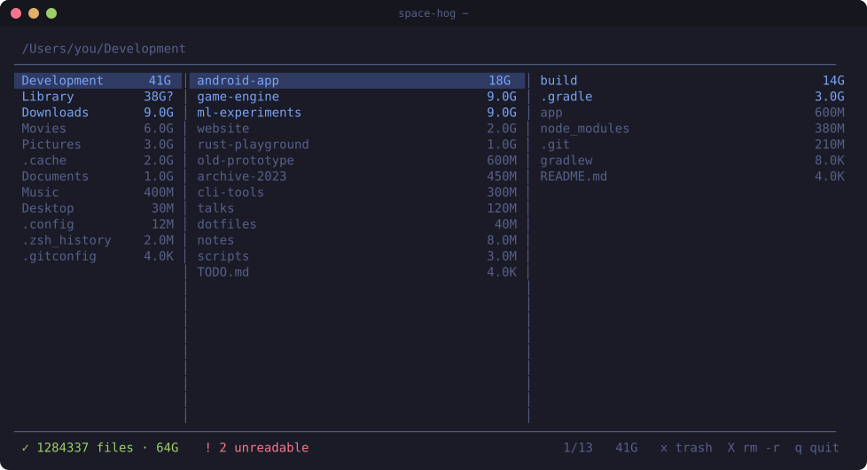
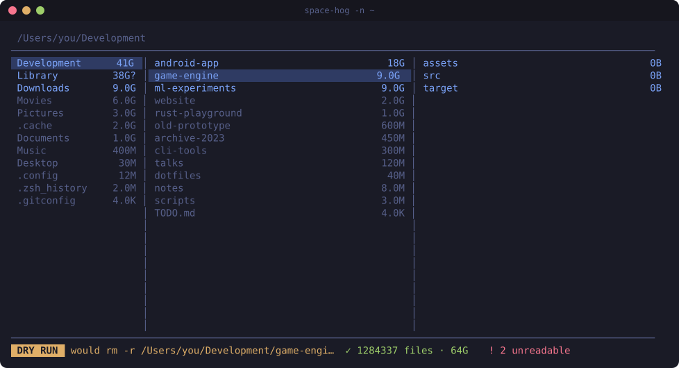
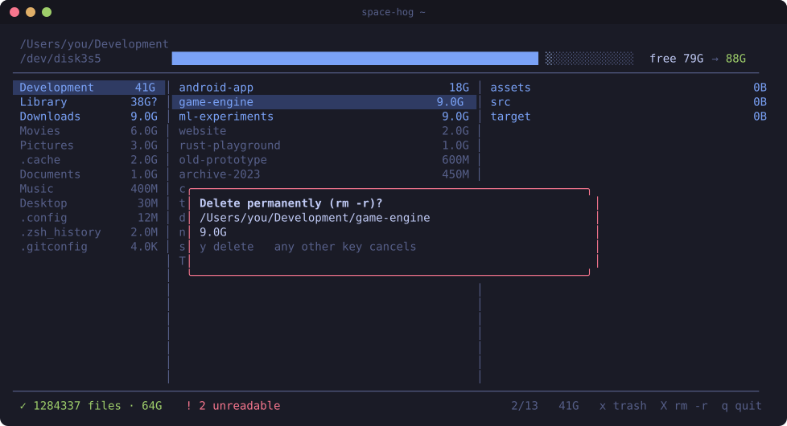
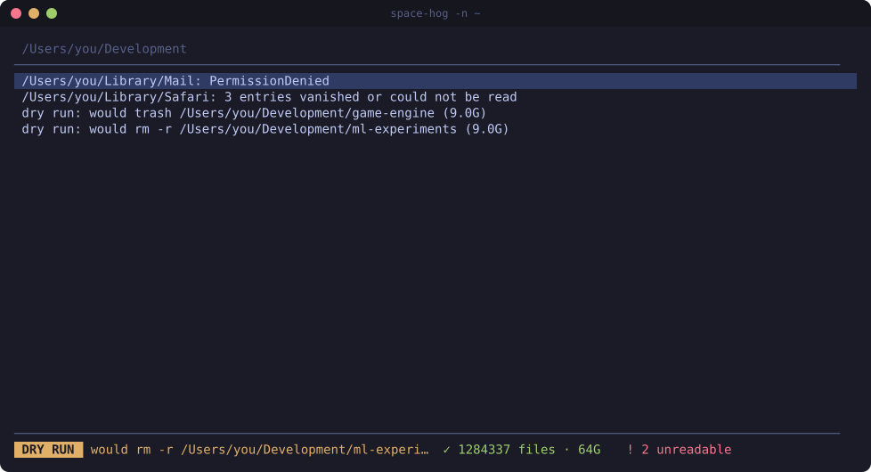

# space-hog

Find what's eating your disk and get rid of it, from the terminal.

space-hog scans a directory tree (like `du`), then lets you browse it in a three-column, [yazi](https://github.com/sxyazi/yazi)-style view with vim keys. The biggest directories are highlighted. When you find something you don't need, move it to the trash or delete it.



Runs on **macOS** and **Linux**.

---

## How to use

### 1. Start with a dry run

Dry run lets you try everything, including the delete keys, without touching the disk:

```bash
space-hog -n ~/Development
```

- `-n` / `--dry-run`: trash and delete only **log what they would do**, for example `would rm -r /Users/you/Development/old-project (3.4G)`.
- The status bar shows a **DRY RUN** banner and the latest "would …" note.
- Press `!` to see every note.



When you're happy with what it would do, run it for real:

```bash
space-hog ~/Development
```

### 2. Pick what to scan

```bash
space-hog                 # your home directory ($HOME)
space-hog /path/to/dir    # any directory
space-hog -j 4 /data      # limit the scan to 4 threads
```

| Option | Meaning |
|---|---|
| `-n`, `--dry-run` | Never trash or delete anything; log what would happen instead. |
| `-j N`, `-jN` | Number of scan threads. Default: one per CPU. Maximum: 256. |
| `PATH` | Directory to scan. Default: `$HOME`. If you give several, the last one wins. |

The view opens right away and fills in while the scan runs. The status bar shows `⟳ scanning …` and switches to `✓ … files · size` when the scan is done.

### 3. Read the screen

```
 path of the current directory
 ─────────────┬─────────────────────────────┬─────────────────────────────
  parent      │  current directory          │  preview: inside the
  directory   │  (sorted by size, biggest   │  selected entry
              │   first; cursor here)       │
 ─────────────┴─────────────────────────────┴─────────────────────────────
  scan progress · errors · pending keys          position  size  key hints
```

- **Sorting:** entries are sorted by size, biggest first. Ties go directories first, then by name (case-insensitive).
- **Sizes:** these are space actually used on disk, with the same numbers `du -h` gives. A sparse 1 GB file with no data shows as almost nothing.
- **Colors:** they point you at what matters.
  - **Blue:** the biggest entries that together make up **80 %** of the directory. Start there.
  - **Dimmed:** each of these is under **15 %** of the directory. They're rarely worth your time.
- **Parent column at the scan root:** it lists the root's real parent directory, unscanned, so those entries have no sizes. Pressing `h` there moves the scan up one level (see [Going up past the start](#going-up-past-the-start)).

Markers after a size:

| Marker | Meaning |
|---|---|
| `?` | Partial size: something inside couldn't be read (permissions, vanished files). Press `!` to see what. |
| `~` | Contains files that are hardlinked elsewhere, so deleting may free **less** than shown. |
| `= /other/path` | The same directory, reached by a second path (macOS firmlinks like `/System/Volumes/Data/Users`, bind mounts). It counts 0 here because it's counted at `/other/path`. You can't enter, trash or delete it through this path. |

### 4. Move around

| Key | Action |
|---|---|
| `j` / `↓` | Down |
| `k` / `↑` | Up |
| `l` / `→` / `Enter` | Enter the selected directory |
| `h` / `←` | Go to the parent directory |
| `gg` | Jump to the top |
| `G` | Jump to the bottom |
| `Ctrl-d` / `Ctrl-u` | Half a page down / up |
| `r` | Rescan the current directory (after you changed things outside space-hog) |
| `!` | Open or close the log (errors and dry-run notes) |
| `q` | Quit |
| `Ctrl-c` | Always quits, from anywhere, even with a custom keymap |

Each directory remembers where your cursor was, so `l` then `h` puts you back on the same entry. While you type a multi-key sequence like `gg`, the keys typed so far show in the status bar.

### 5. Free space

| Key | Action |
|---|---|
| `x` | **Move to trash.** No confirmation. You can restore it from the trash. |
| `X` | **Delete permanently** (`rm -r`). Opens a confirmation showing the path and size. Only `y` deletes; **any other key cancels**. |



After a delete, the entry disappears and every parent directory's size goes down by the same amount. You don't need to rescan.

Where the trash goes:

- **macOS:** `~/.Trash`, with names that already exist getting ` 2`, ` 3`, … appended.
- **Linux:** the FreeDesktop trash, `$XDG_DATA_HOME/Trash` (usually `~/.local/share/Trash`). Each item gets a `.trashinfo` file, so file managers and `trash-restore` can put it back.
- **Other volumes:** only your home volume's trash is used. To remove something on another disk, use `X`.

Safety checks: space-hog **refuses** to trash or delete, and logs why, when:

- **a parent directory was swapped for a symlink** since the scan, so the path would now point somewhere else;
- **the target contains a mount point**, because deleting it would also wipe another filesystem;
- **the entry is a `=` alias** of a directory counted elsewhere.

If an `rm -r` fails halfway (for example on a read-only directory), the error is logged and the directory is rescanned. The view then shows exactly what's left on disk.

### 6. Going up past the start

When you're at the scan root, the parent column shows the real parent directory. Press `h` there to make it the new root:

- What you already scanned is kept.
- Only the new sibling directories get scanned.

Keep pressing `h` to work your way up to `/`.

### 7. The log (`!`)

The log lists:

- directories that couldn't be read (with partial sizes, marked `?`);
- trash or delete failures and refusals;
- keymap problems;
- dry-run notes.



Inside the log, `j` `k` `gg` `G` `Ctrl-d` `Ctrl-u` scroll, and `!` or `q` close it. `q` here closes the log; it doesn't quit.

The status bar's `! N unreadable` counts every entry in the log except dry-run notes.

---

## Custom keys

Create `~/.config/space-hog/keymap.zon`, or `$XDG_CONFIG_HOME/space-hog/keymap.zon` if you set `XDG_CONFIG_HOME`:

```zig
.{
    .trash = .{ "d" },              // d trashes instead of x
    .delete = .{ "D" },
    .top = .{ "gg", "<C-g>" },      // several keys for one action
    .quit = "Q",                    // a single string works too
    .rescan = .{},                  // empty list: unbind
}
```

How the file is read:

- **Unlisted actions** keep their default keys.
- **Listing an action** replaces all of its default keys.
- **A key you bind** is removed from whatever action had it before.
- **Errors never stop the app:** a broken file, an unknown action or a bad key is skipped and logged, and the defaults are used.

**Actions:** `down` `up` `parent` `enter` `top` `bottom` `half_down` `half_up` `trash` `delete` `rescan` `log` `quit`

**Key notation** (vim-style), up to 4 keys per binding:

| Write | For |
|---|---|
| `j`, `G`, `é` | that character (uppercase means Shift) |
| `gg`, `ge` | a sequence: press the keys one after another, with no time limit |
| `<C-d>` | Ctrl + a letter (letters only) |
| `<up>` `<down>` `<left>` `<right>` | arrow keys |
| `<esc>` `<cr>` `<enter>` `<tab>` `<space>` `<lt>` | Esc, Enter, Tab, Space, `<` |

Notes:

- **Reserved key:** `Ctrl-c` always quits and can't be bound.
- **Ignored modifiers:** keys pressed with Alt, Super or Meta are ignored, so a stray Alt+x never trashes anything.
- **Prefix conflicts:** if a binding is the start of another one (`g` when `gg` exists), the shorter one can never fire. The log tells you when that happens.

---

## Install / build

**Prebuilt:** every `v*` tag publishes binaries on the [Releases](https://github.com/cosmopool/space-hog/releases) page. Download the `.tar.gz` for your system, check it against `SHA256SUMS`, and put the `space-hog` binary inside it on your `PATH`.

| Archive | For |
|---|---|
| `aarch64-macos` / `x86_64-macos` | Apple Silicon / Intel Macs |
| `x86_64-linux-musl` / `aarch64-linux-musl` | Any Linux; fully static, no libc needed (Alpine included) |
| `x86_64-linux-gnu` / `aarch64-linux-gnu` | glibc distributions; needs glibc 2.17+ |

On Linux, space-hog needs **kernel 4.11 or newer** (it reads file metadata with `statx`).

**From source:**

You need **Zig 0.17.0** ([download](https://ziglang.org/download/), or `zvm install 0.17.0`). The first build downloads the dependencies ([libvaxis](https://github.com/rockorager/libvaxis) and what it needs) into `zig-pkg/`; later builds work offline.

```bash
zig build -Doptimize=ReleaseSafe
./zig-out/bin/space-hog -n
```

Copy `zig-out/bin/space-hog` somewhere on your `PATH`. The binary is self-contained.

The screenshots in this README are generated by `zig build screenshots`. That step feeds mock scan results to the real core, draws them with the app's own `paint()` code, and writes `docs/img/*.svg`. Re-run it after UI changes.

Cross-compiling:

```bash
zig build -Doptimize=ReleaseSafe -Dtarget=aarch64-macos       # Apple Silicon
zig build -Doptimize=ReleaseSafe -Dtarget=x86_64-macos        # Intel Mac
zig build -Doptimize=ReleaseSafe -Dtarget=x86_64-linux-musl   # static Linux binary
zig build -Doptimize=ReleaseSafe -Dtarget=aarch64-linux-musl
```

`ReleaseSafe` keeps runtime safety checks on. It's the recommended mode for a tool that deletes files.

---

## How sizes are counted

The rules are the same as `du -h -d 1`:

- **Symlinks** are never followed; a link counts only its own few bytes.
- **Other filesystems** mounted inside the tree are scanned, but deleting into them is refused (see [Free space](#5-free-space)).
- **Hardlinked files** are counted once, in the first directory where the scan finds them.
- **The same directory reached by two paths** is counted once; the other path shows as `=`.
- **Sizes** are blocks on disk (`st_blocks × 512`), not apparent file length.

---

## Development

```bash
zig build test     # run after every change
zig build check    # before calling something done: tests, Debug + ReleaseSafe builds, Linux cross-compiles
```

- **Tests** are integration tests: through the app's public API, on real temporary directories (sizes compared against `du`), and painting the UI into an in-memory screen. Fuzz targets for hostile file names and keymap files live in `test/fuzzy/`. See `AGENTS.md` and `.agents/rules/testing.md`.
- **Architecture:** the core (`src/core.zig` + tree, rules, keymap, view) never touches the disk or the terminal. The platform entry points (`src/platform/`) run the loop, and `src/fsops.zig` performs the side effects.
- **Design decisions** and their alternatives are in [`docs/decisions.md`](docs/decisions.md).

---

## License

[BSD 3-Clause](LICENSE) © 2026 Kaio Delphino. You can use, modify and redistribute it, in source or binary form, as long as you keep the copyright notice and license text, and you don't use the author's name to promote derived products without permission.

The binaries include third-party code (Zig standard library, libvaxis, zigimg, uucode, and musl in the static Linux builds), all under permissive licenses; their notices are in [THIRD_PARTY_LICENSES](THIRD_PARTY_LICENSES) and ship in every release archive.
